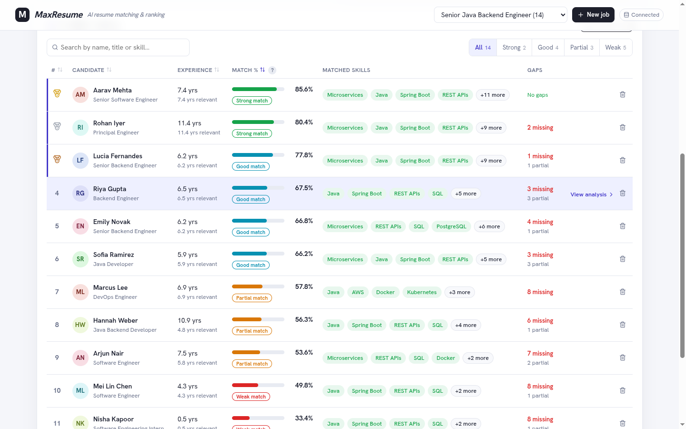

# MaxResume: AI resume matching & candidate ranking

Upload a job description and a batch of resumes. MaxResume extracts the requirements, parses every
resume into a structured profile (with a parse-quality check), scores each candidate **0–100** with a
hybrid **skills + experience + semantic-similarity** model, and shows a ranked shortlist where every
score is explained. Every action is recorded in a tamper-evident audit log.

**Stack:** React 18 (Vite) · Python 3.11+ / FastAPI · `all-MiniLM-L6-v2` sentence embeddings on ONNX Runtime + spaCy ·
Tesseract OCR · MongoDB (with an in-memory fallback) · Docker Compose.

| Document | What it covers |
|---|---|
| [docs/ALGORITHM.md](docs/ALGORITHM.md) | matching algorithm, how the % is calculated, a worked example |
| [docs/OPERATIONS.md](docs/OPERATIONS.md) | logging, audit trail, ingestion safeguards, configuration, security, deployment, runbook |
| [docs/DEMO.md](docs/DEMO.md) | end-to-end walkthrough with screenshots from the live site, talking points and likely questions |

**Live demo:** <https://maxresume.onrender.com> (free tier: allow ~1 minute to wake up)



---

## Features

| Module | What you get |
|---|---|
| 1. Job description | Paste text, or upload / drag & drop a PDF, DOCX or TXT file. Extracts must-have vs nice-to-have skills, `A or B` alternatives, years of experience, degree level and field, and requirement statements. Everything is editable, and saving re-scores all candidates. |
| 2. Resume upload | Drag & drop up to 50 files per batch (**PDF, DOCX, DOC, ODT, RTF, TXT**), parsed in parallel. Bad, unsafe or duplicate files are rejected with a clear reason, without failing the batch. |
| 3. AI matching | Exact/alias skill matching, substitute skills (MySQL for PostgreSQL), implied skills (GitLab CI ⇒ CI/CD), **semantic skill inference** (“event streaming platform” ⇒ Kafka), relevant vs unrelated experience, and sentence-level semantic fit. |
| 4. Ranking dashboard | Sortable/filterable table (candidate, experience, match %, matched skills, gaps), summary stats, low-confidence parse flags, CSV export. |
| 5. Candidate analysis | Score breakdown with the exact formula, reasons, matched/partial/missing skills with the resume line they came from, experience comparison with per-role relevance, semantic evidence, education check, extracted info, **how the resume was read** (quality checks, OCR/columns, file fingerprint, scorer version), and the original file. |

### Production-grade resume parsing

* **File handling:** type detected from content (magic bytes), size/page limits, zip-bomb protection,
  clean rejection of password-protected, corrupt, image or executable files.
* **Hard layouts:** two-column/sidebar PDFs are read column by column; scanned PDFs are **OCR'd** with
  Tesseract; contact details in DOCX page headers, text boxes and nested tables are read; embedded
  hyperlinks (a "LinkedIn" label) recover profile URLs; legacy `.doc/.rtf/.odt` are converted with LibreOffice.
* **Fields:** phones validated and normalised to E.164 with Google's libphonenumber; emails validated;
  name from layout → spaCy NER → email, with the source recorded; skill names are never mistaken for
  names or places.
* **Dates:** `Mar 2019 – Present`, `03/2019 - 06/2022`, `Jan '19 – Feb '22`, `Since March 2022`,
  `Summer 2019`, `2018 to 2020`; overlapping roles counted once; career gaps; future or implausible dates ignored.
* **Parse quality:** 10 checks give each resume a 0–100 confidence; low-confidence parses are flagged so a person checks the original.

### Operations

* Structured JSON logs with request ids and **PII redaction** (no emails/phones in logs).
* **Hash-chained audit log** of every action (who, what, when, before → after), with an integrity check
  that detects edited or deleted entries. Candidate views and downloads are audited too.
* Optional API-key auth (the key's name becomes the audit actor), security headers, one error format,
  CSV formula-injection protection, liveness/readiness endpoints, Docker images.

One-click **sample data** (5 JDs, 14 synthetic resumes, and a set of *tricky files*; plus a 1 JD + 5 resume demo set in `sample_data/video_demo/`) makes it easy to demo.

## Architecture

```
┌──────────────────────┐  /api   ┌────────────────────────────────────────────────────────────┐
│ React (Vite / nginx) │ ──────► │ FastAPI                                                    │
│  JobForm             │         │  middleware.py   request id, auth → actor, access log      │
│  Requirements editor │         │  main.py         routes, validation, error format          │
│  Uploader            │         │  service.py      orchestration, provenance, edit diffs     │
│  RankingTable        │         │  audit.py        hash-chained audit log + verify           │
│  CandidatePanel      │         │  ingest/         detect (magic bytes, limits) · extractors │
│  AuditPanel          │         │                  (PDF columns + OCR, DOCX, DOC/RTF/ODT)    │
└──────────────────────┘         │  nlp/            sections · skills · dates · resume/JD     │
                                 │                  parsers · quality checks · embeddings     │
                                 │  matching/scorer.py   scoring + reasons                    │
                                 │  db.py           MongoDB / in-memory                       │
                                 └──────────────────────────┬─────────────────────────────────┘
                                                            │
                                    MongoDB: jobs · candidates · files · audit_log
```

* Parsing happens once per resume. Editing the JD or weights only re-runs the (fast) scorer.
* CPU-bound work runs in worker threads with a concurrency limit and per-file timeout.
* Every score stores its provenance (scorer version, model, weights, time) so it can be reproduced.

## Matching algorithm & scoring

Full methodology with a worked example: [docs/ALGORITHM.md](docs/ALGORITHM.md).

**Score (0–100)** is a weighted sum of five components, each scored 0–1:

```
score = Σ (wᵢ / Σ active w) × componentᵢ × 100
weights: required skills 40 · relevant experience 20 · semantic fit 20 · nice-to-have skills 10 · education 10
```

If the JD doesn't specify a component (e.g. no degree), it is dropped and the other weights are rescaled.

| Component | How it is calculated |
|---|---|
| **Required / nice-to-have skills** | Each JD skill takes its best evidence: **1.0** named and used in a role · **0.85** only listed, or implied (PostgreSQL ⇒ SQL) · **0.5** substitute from the same family (MySQL for PostgreSQL; 0.85 if the JD says "or similar") · **0.5** meaning match: a resume sentence has cosine similarity ≥ 0.62 with the skill's description ("event streaming platform" ⇒ Kafka) · **0** missing. `A or B` counts as one requirement. Component = average credit. |
| **Relevant experience** | A role is relevant if its title (≥ 0.60) or description (≥ 0.50) is similar to the JD, or it uses ≥ max(2, 25%) of the required skills. Relevant years are the union of those roles' dates. `effective = relevant + min(0.25 × unrelated, 0.5 × min_years)`; component = `min(1, effective / min_years)`. |
| **Semantic fit** | Each JD requirement sentence is matched to its closest resume sentence (all-MiniLM-L6-v2). Similarity is rescaled `clip((sim − 0.25) / 0.45, 0, 1)` and averaged. |
| **Education** | Level: meets 1.0, one below 0.5, else 0 (≥ 0.7 with "or equivalent experience" and enough years). Component = `0.75 × level + 0.25 × field match`. |

**Verdict:** Strong ≥ 80 · Good ≥ 65 · Partial ≥ 50 · Weak below 50. **Reasons** are generated from the same
evidence objects as the score, so the explanation always agrees with the number.

Example: Riya Gupta vs Senior Java Backend Engineer: `40%×0.68 + 20%×1.00 + 20%×0.41 + 10%×0.21 + 10%×1.00 = 67.5%` (Good match).

## Run it

### Option A: Docker (everything included)

```bash
git clone https://github.com/devdaveddev/MaxResume.git
cd MaxResume
docker compose up --build          # http://localhost:8080
```

### Option B: local development

Clone the repo first (see Option A). Prerequisites: Python 3.11+ with [uv](https://docs.astral.sh/uv/), Node.js 18+, MongoDB 6+ (optional:
without it the API uses in-memory storage). Optional system tools: `tesseract` (scanned PDFs),
`libreoffice` / `antiword` (`.doc/.rtf/.odt`). Without them those formats are rejected with a clear message.

```bash
# API
cd backend
uv sync                                     # deps incl. ONNX Runtime and the spaCy model (no PyTorch needed)
uv run uvicorn app.main:app --port 8000     # first start downloads the embedding model (~90 MB)

# UI (second terminal)
cd frontend
npm install
npm run dev                                 # http://localhost:5173 (proxies /api to :8000)
```

If the API runs on another port: `API_URL=http://localhost:8001 npm run dev`.
Configuration is via environment variables; see [`backend/.env.example`](backend/.env.example).

### Option C: free public deployment (Render)

[`render.yaml`](render.yaml) deploys the whole app as one free web service from a lean image that fits
512 MB (same matching results; `.rtf` unsupported there). Steps and trade-offs:
[`deploy/render/README.md`](deploy/render/README.md).

### Option D: Hugging Face Spaces (requires a PRO plan for Docker Spaces)

[`deploy/huggingface/`](deploy/huggingface) holds an all-in-one image (the React build is served by the
FastAPI process on port 7860) and a script that uploads exactly the committed code to a Docker Space:

```bash
uvx --from huggingface_hub hf auth login                     # once, with a write token
uv run --with huggingface_hub python deploy/huggingface/deploy.py --space <user>/maxresume
```

The free CPU tier (2 vCPU, 16 GB RAM) runs everything, OCR and LibreOffice included. Without a
`MONGO_URL` Space secret, data lives in memory and resets when the Space restarts.

### Try it
Click **Senior Java Backend Engineer** under *Try a sample*, then **Extract requirements** →
**Add sample resumes** → **Analyse**. Click **Try tricky files** to see OCR, two-column parsing and
rejections in action, and **Activity log → Verify integrity** to see the audit trail.

## Tests

[](https://github.com/devdaveddev/MaxResume/actions/workflows/ci.yml)

```bash
cd backend && uv run pytest                  # 63 tests
uv run python scripts/eval_parsing.py        # field-level parsing accuracy report
```

Every push runs the backend tests, lint and accuracy report, plus the frontend lint and build, in GitHub Actions.

| Suite | Covers |
|---|---|
| `test_parsing.py` | skill/alias edge cases, date formats, overlap merging, sections, resumes in 3 layouts, JD parsing |
| `test_ingest.py` | magic-byte detection, zip bomb, oversized/empty/executable/encrypted/corrupt files, two-column PDF, OCR, DOCX headers & hyperlinks, `.doc/.rtf/.odt` parity, tricky dates, parse-quality flags |
| `test_scoring.py` | score properties, weight re-normalisation, substitute/semantic credit, relevant vs unrelated experience, sample ranking |
| `test_unseen_jds.py` | JDs in shapes the parser was not built against (bulleted, inline *Must have / Good to have*, one paragraph); the right candidate ranks first for each |
| `test_production.py` | audit chain + tamper detection, audited API actions with diffs, PII redaction, request ids, API-key auth, error shape, filename sanitisation, CSV injection, framing policy, server config |
| `test_api.py` | end-to-end batch upload, ranking, rescoring |
| `test_eval.py` | parsing-accuracy regression gate (fails below 98%) and a check that the evaluator catches errors |

### Parsing accuracy

`scripts/eval_parsing.py` compares every parsed field with known ground truth: name, email, phone, location,
LinkedIn, each role's title, company, start and end, total years, degree level, institution and graduation
year, plus skill precision/recall.

| Set | Resumes | Field checks | Field accuracy | Skills F1 |
|---|---:|---:|---:|---:|
| Standard samples (3 layouts, PDF + DOCX) | 14 | 253 | 100% | 100% |
| Edge cases (two-column, scanned/OCR, DOC/RTF/ODT, tricky dates) | 7 | 116 | 100% | 100% |
| Unseen layouts, dev set (tables, `NAME — Title`, odd headings, plain text) | 4 | 68 | 100% after fixes | 100% |
| **Unseen layouts, held-out set: blind first run** | **3** | **51** | **92.2%** | **100%** |

How to read this honestly:
- The first two sets were generated alongside the parser, so they are a regression baseline, not proof of
  generalisation.
- The **dev set** was written to find weaknesses: its first run exposed 6 bugs (table headers taken as
  companies, `NAME — Title` headers, bracketed dates, foreign institution names, local phone formats), which
  were fixed.
- The **held-out set** was written afterwards, with ground truth fixed before the first run.
  **Blind result: 92.2%**, with every name, contact, date, degree and skill correct. The 4 misses were one
  pattern ("Senior Consultant **@** Deloitte"), since fixed, so this set now also scores 100%.
- The evaluator is verified to catch planted errors. Low-confidence parses are flagged in the UI so a person
  checks the original file.

## API

| Method | Path | Description |
|---|---|---|
| `GET` | `/api/health` · `/api/ready` | liveness · readiness (DB + models) |
| `POST` | `/api/jobs` | create a job (form: `text` and/or `file`, optional `title`) |
| `GET` | `/api/jobs` · `/api/jobs/{id}` | list / get jobs |
| `PUT` | `/api/jobs/{id}` | edit skills, years, education, weights → re-score all candidates |
| `DELETE` | `/api/jobs/{id}` | delete a job and its candidates |
| `POST` | `/api/jobs/{id}/resumes` | batch upload (multipart `files`) |
| `GET` | `/api/jobs/{id}/candidates` | ranked summaries |
| `GET` | `/api/jobs/{id}/export.csv` | ranking as CSV |
| `GET` | `/api/candidates/{id}` | full analysis incl. parse quality |
| `GET` | `/api/candidates/{id}/file` | original uploaded file |
| `DELETE` | `/api/candidates/{id}` | remove a candidate |
| `GET` | `/api/audit` · `/api/audit/verify` | audit entries (filter by job/action/actor/since) · chain integrity check |
| `GET` | `/api/samples` · `/api/samples/{group}/{name}` | demo data |

Interactive docs: `/docs` on the API.

## Project layout

```
backend/
  app/            FastAPI app, ingestion, NLP pipeline, scorer, audit, persistence
  scripts/        generate_samples.py, generate_edge_cases.py (synthetic test data)
  tests/
  Dockerfile
frontend/         React app (+ Dockerfile, nginx.conf)
sample_data/      2 JDs, 14 synthetic resumes, edge_cases/
docs/             ALGORITHM.md, OPERATIONS.md
docker-compose.yml
```

## Data & privacy

All sample resumes are **synthetic**: invented names, `example.com` emails, 555-range phone numbers.
They are generated by the scripts in `backend/scripts/`. No real candidate data is used.
