# End-to-end demo

A 6–8 minute walkthrough that shows every module of the brief with the synthetic demo data in this
repository. Every screenshot below was captured from a real run on the live deployment
(<https://maxresume.onrender.com>): one Word job description and 14 resumes uploaded from disk.

## Before you start

| | |
|---|---|
| **Demo data** | Job description: [`sample_data/job_descriptions/senior_java_backend_engineer.docx`](../sample_data/job_descriptions/senior_java_backend_engineer.docx) · Resumes: all 14 files in [`sample_data/resumes/`](../sample_data/resumes) (7 PDF + 7 DOCX, all fictional people) |
| **Live site** | Open it **2 minutes early** and upload one resume to any job: the free tier sleeps when idle and the first upload after waking loads the AI models (~50 s). |
| **Local alternative** | `docker compose up --build`, or the local dev setup in the README. Same results, ~30× faster. |
| **Expected time** | The 14-resume batch takes ~2 minutes on the free tier (the progress bar keeps it visible), ~5 seconds locally. |

## Walkthrough

### 1. Landing page (30 s)
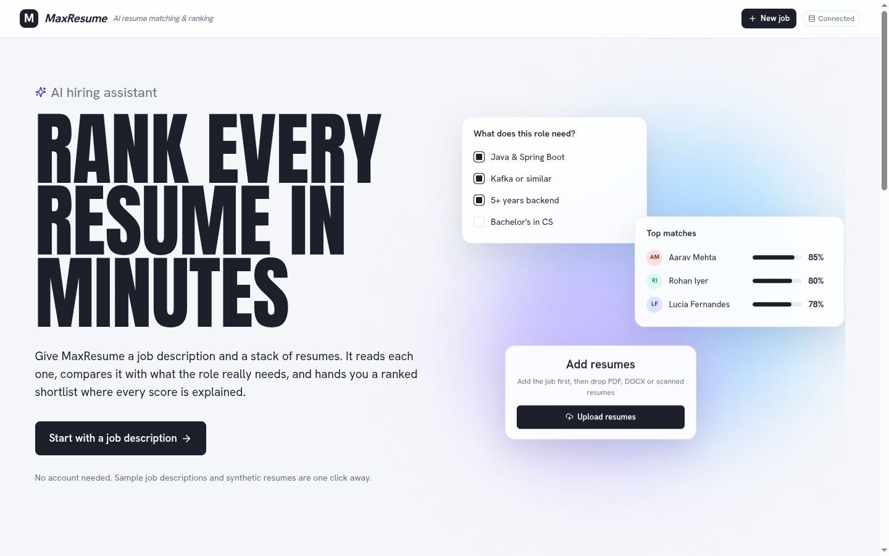

> "MaxResume compares a batch of resumes with one job description and ranks them, with every score explained.
> React frontend, FastAPI backend, sentence embeddings plus spaCy for the NLP, MongoDB for storage."

### 2. Module 1: upload the job description (45 s)
Click **Start with a job description → Upload a JD file**, choose the `.docx`, click **Extract requirements**.

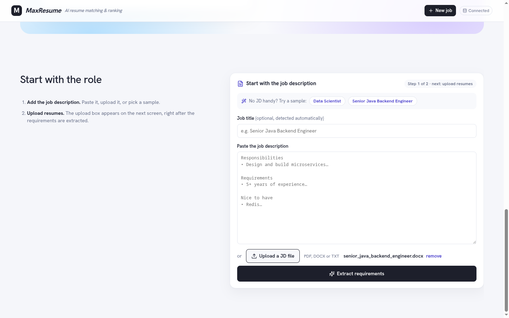
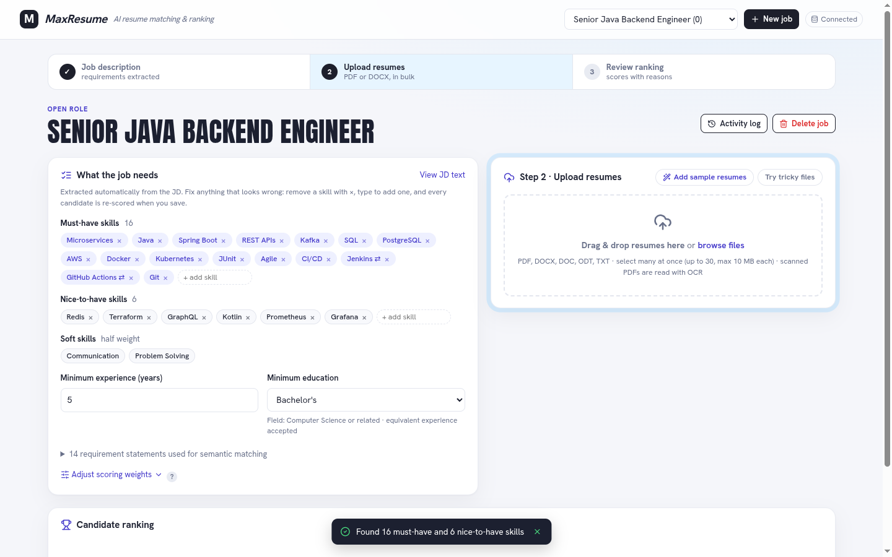

> "From the Word file it extracted 16 must-have skills, 6 nice-to-haves, 5+ years and a Bachelor's in CS.
> It understood that 'Jenkins or GitHub Actions' means either one (⇄), and that lines saying 'nice to have',
> 'a plus' or 'familiarity with' are preferred, not required. A recruiter can fix anything here and every
> candidate is re-scored."

**Requirement shown:** paste or upload a JD; extract skills, experience and qualifications.

### 3. Module 2: upload 14 resumes in one batch (1–2 min)
Drag all 14 files from `sample_data/resumes/` onto **Step 2 · Upload resumes**, click **Analyse 14 resumes**.

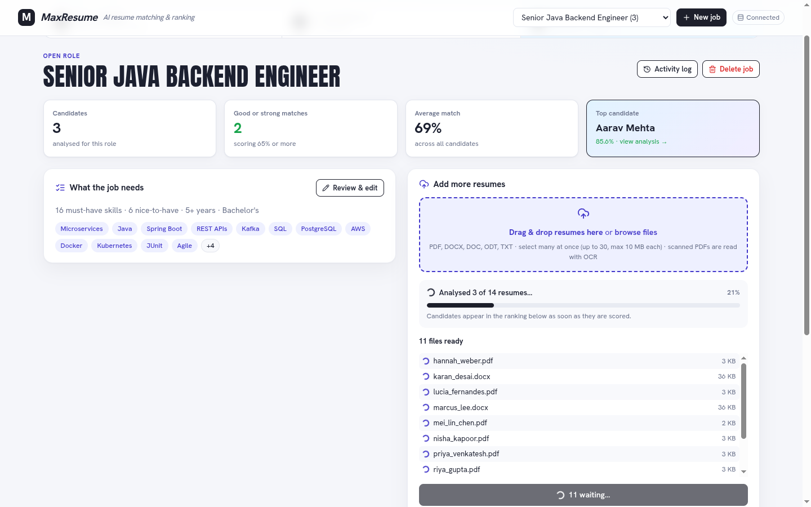

> "Fourteen resumes, PDF and Word mixed, in one batch. Files are checked by their content, not their
> extension, parsed in parallel, and candidates appear in the ranking as soon as they're scored."

While it runs, mention: scanned PDFs are OCR'd, two-column layouts are handled, and broken or
password-protected files are rejected with a reason without failing the batch (the **Try tricky files** button shows this).

**Requirement shown:** ≥ 10 resumes in one batch, PDF and DOCX, candidate details extracted.

### 4. Module 4: ranking dashboard (45 s)
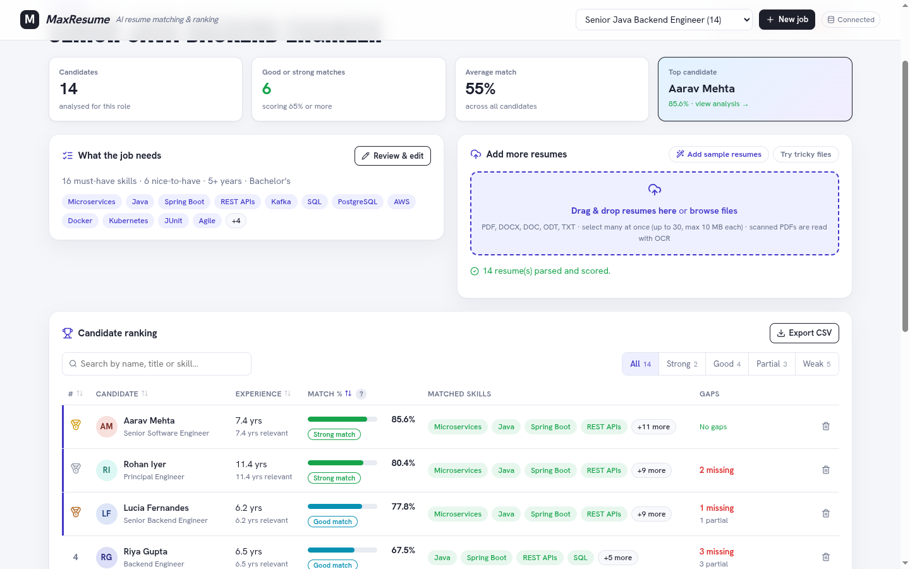
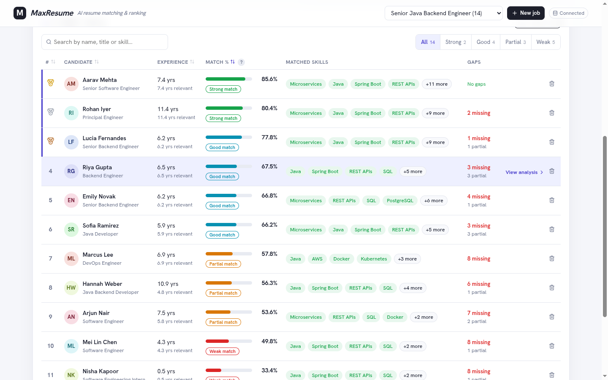

> "The table has the columns the brief asks for: candidate, experience, match % and matched skills, plus
> gaps. The Java backend engineers rank at the top; the data scientists and the frontend developer drop to
> the bottom with **0 relevant years**, because their roles don't match this job even though they have
> 4–6 years of experience."

Also show: sorting, the Strong / Good / Partial / Weak filters, search by skill, **Export CSV**.

### 5. Module 5: candidate analysis (2 min, the most important part)
Click **Riya Gupta** (67.5%).

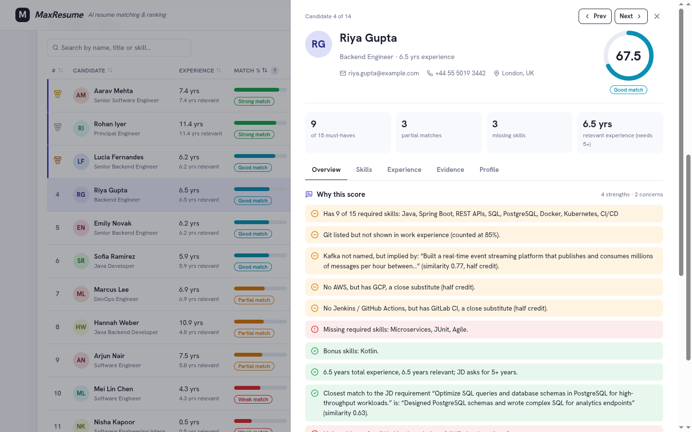

> "Each reason is backed by evidence. Note this one: Kafka isn't mentioned anywhere on her resume, but she
> 'built a real-time event streaming platform that publishes and consumes messages'. The semantic model
> matches that with 0.77 similarity, so she gets half credit. That's the 'semantic, not just keyword'
> requirement."

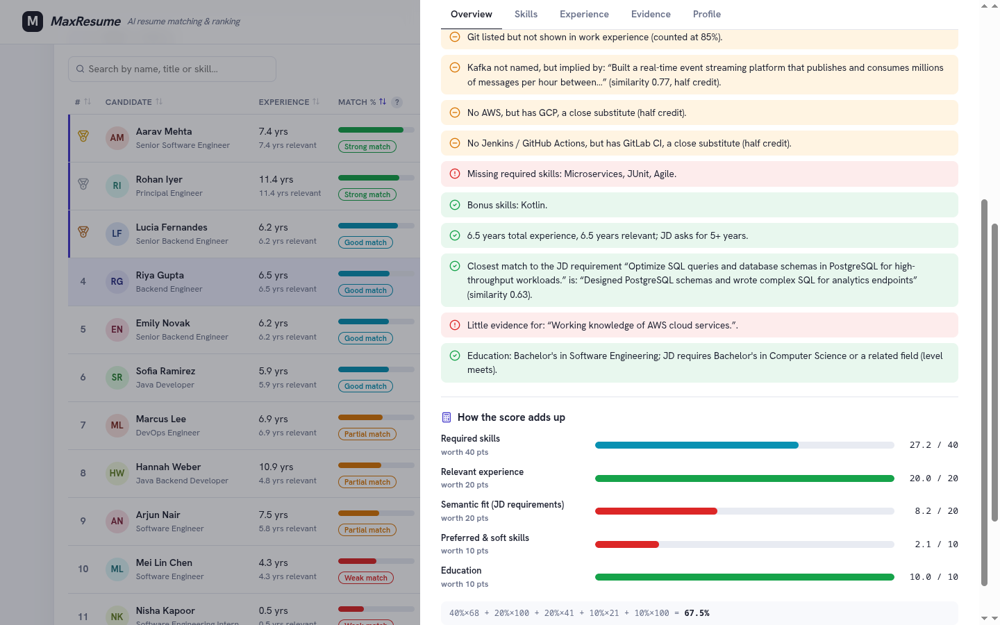

> "And this is exactly how the percentage is calculated: 40% required skills × 68 + 20% experience × 100 +
> 20% semantic fit × 41 + 10% nice-to-have × 21 + 10% education × 100 = **67.5%**."
> (Full derivation: [ALGORITHM.md §5](ALGORITHM.md#5-worked-example--riya-gupta-vs-senior-java-backend-engineer).)

Then the tabs:

| Tab | Screenshot | Say |
|---|---|---|
| **Skills** | 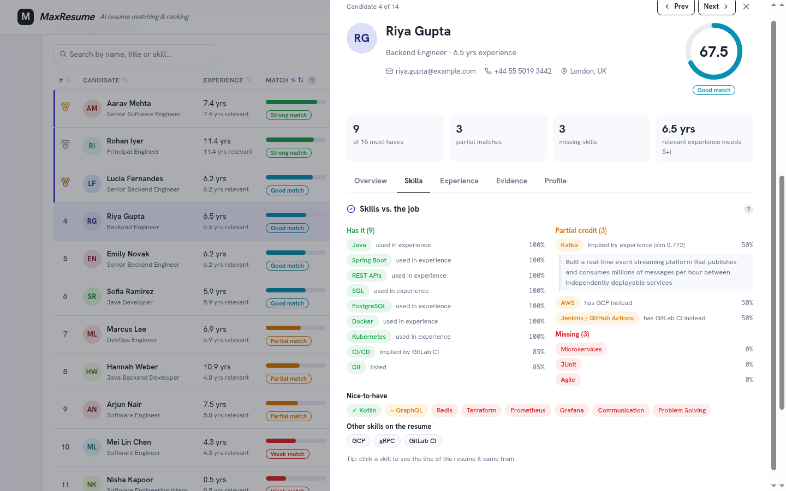 | Matched, partial and missing skills with the credit each earns; click one to see the resume line it came from. GCP counts half for AWS (substitute), GitLab CI satisfies CI/CD. |
| **Experience** | 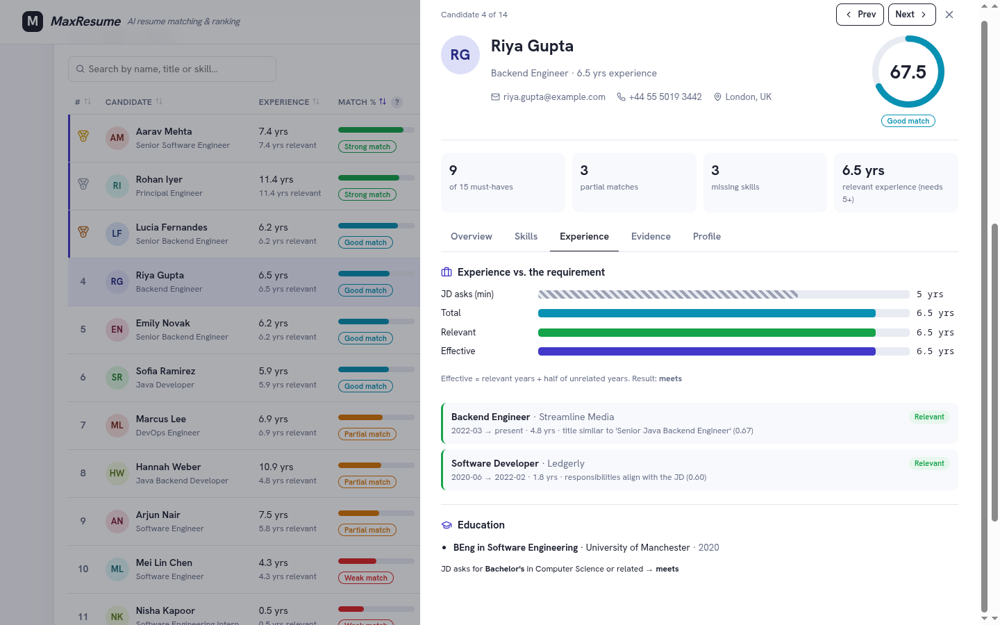 | Required vs total vs relevant years; each role marked relevant or unrelated, with the reason. |
| **Evidence** | 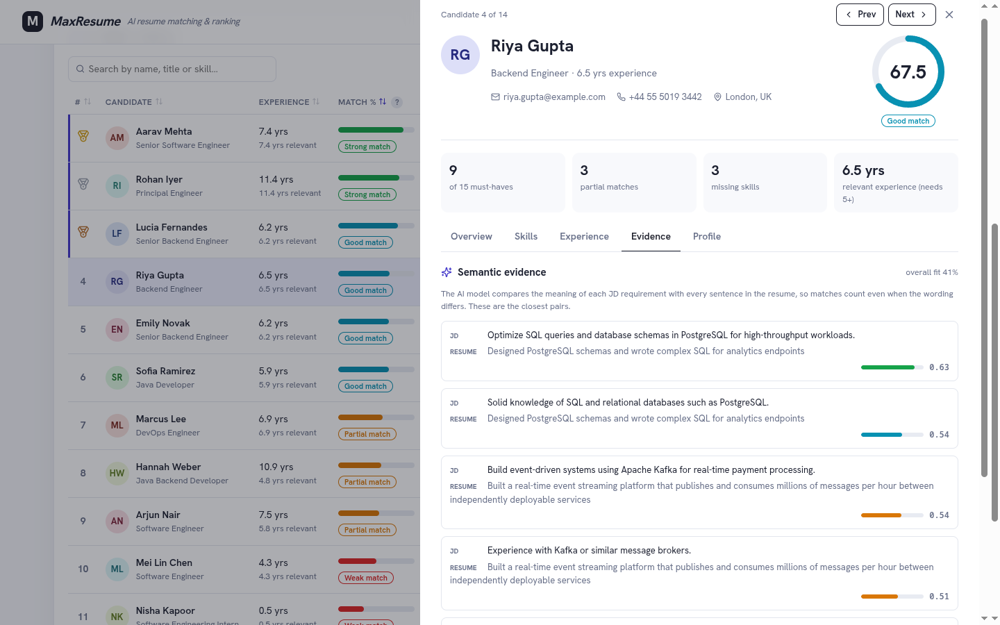 | JD requirement ↔ closest resume sentence by meaning, with similarity. |
| **Profile** | 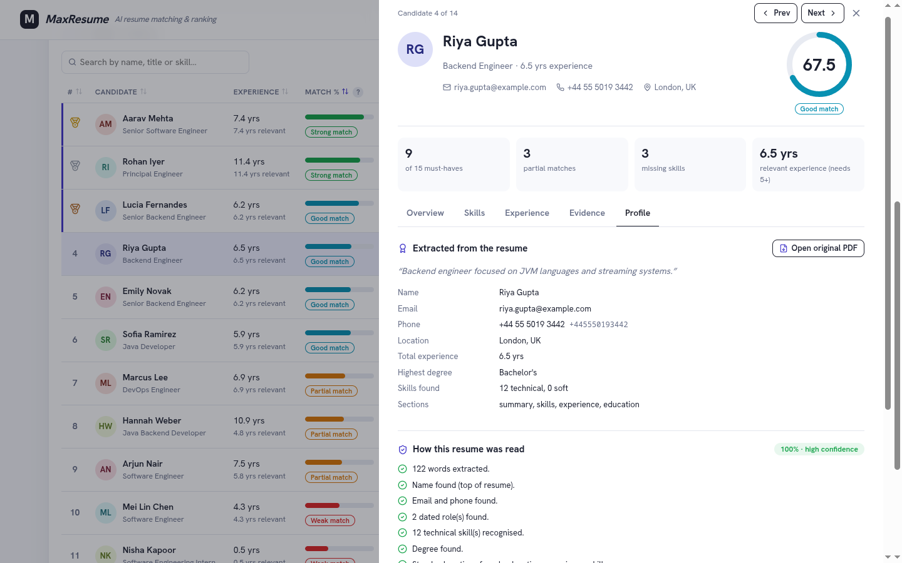 | Everything extracted from the file, plus how it was read: parse-quality checks, method, fingerprint, scorer version. |

**Requirement shown:** extracted info, overall score, matching and missing skills, experience comparison, reasons.

### 6. Close: trust and operations (30 s)
**Activity log → Verify integrity**.

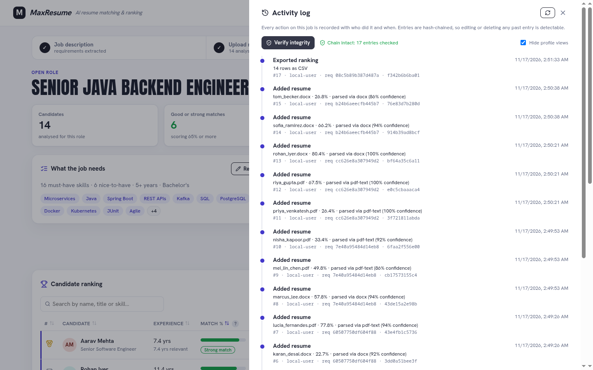

> "Every action is recorded and hash-chained, so tampering is detectable. The code is on GitHub with
> 56 tests, a field-level parsing-accuracy check, and documentation of the algorithm."

## Questions you will likely get

| Question | Short answer |
|---|---|
| How is the % calculated? | Weighted sum of five parts (40/20/20/10/10); components the JD doesn't specify are dropped and the rest re-normalised. See ALGORITHM.md. |
| Why not just one embedding similarity? | A single resume↔JD cosine is opaque and unstable; explicit skill coverage is precise and explainable. Embeddings are used where they help: paraphrases and role relevance. |
| How do you avoid keyword stuffing? | Skills used in work experience score 1.0; skills only listed score 0.85; semantic fit measures what the candidate *did*, not the skills list. |
| How accurate is parsing? | 100% on 369 field checks across 21 synthetic resumes (`scripts/eval_parsing.py`); it's a regression baseline on known layouts, and low-confidence parses are flagged for a human. |
| Is it Sentence Transformers? | Yes, `all-MiniLM-L6-v2`, run on ONNX Runtime to fit the free host; `scripts/compare_engines.py` shows 0.00-point score difference vs PyTorch. |
| What would you improve? | Calibrate thresholds on labelled recruiter decisions, broaden the skill taxonomy beyond tech, add multilingual support, persistent storage on the live demo. |
